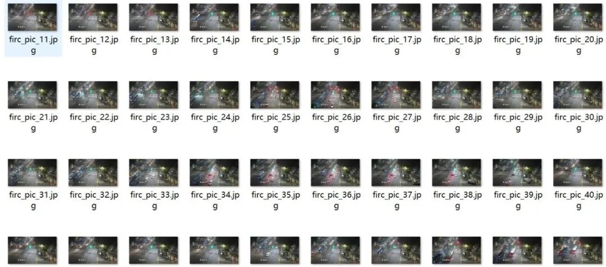
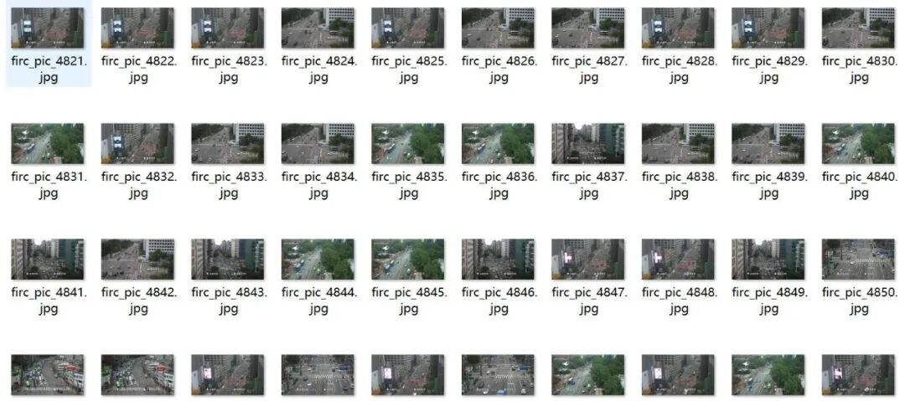
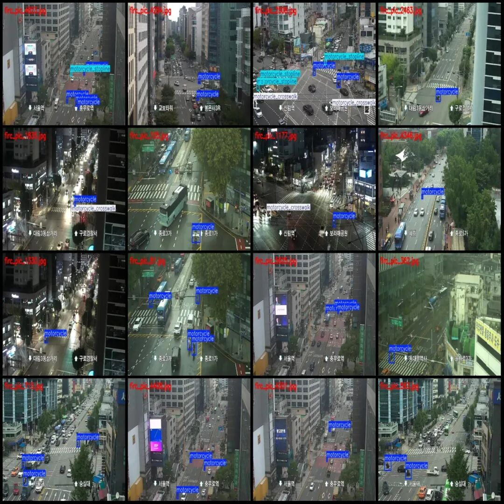
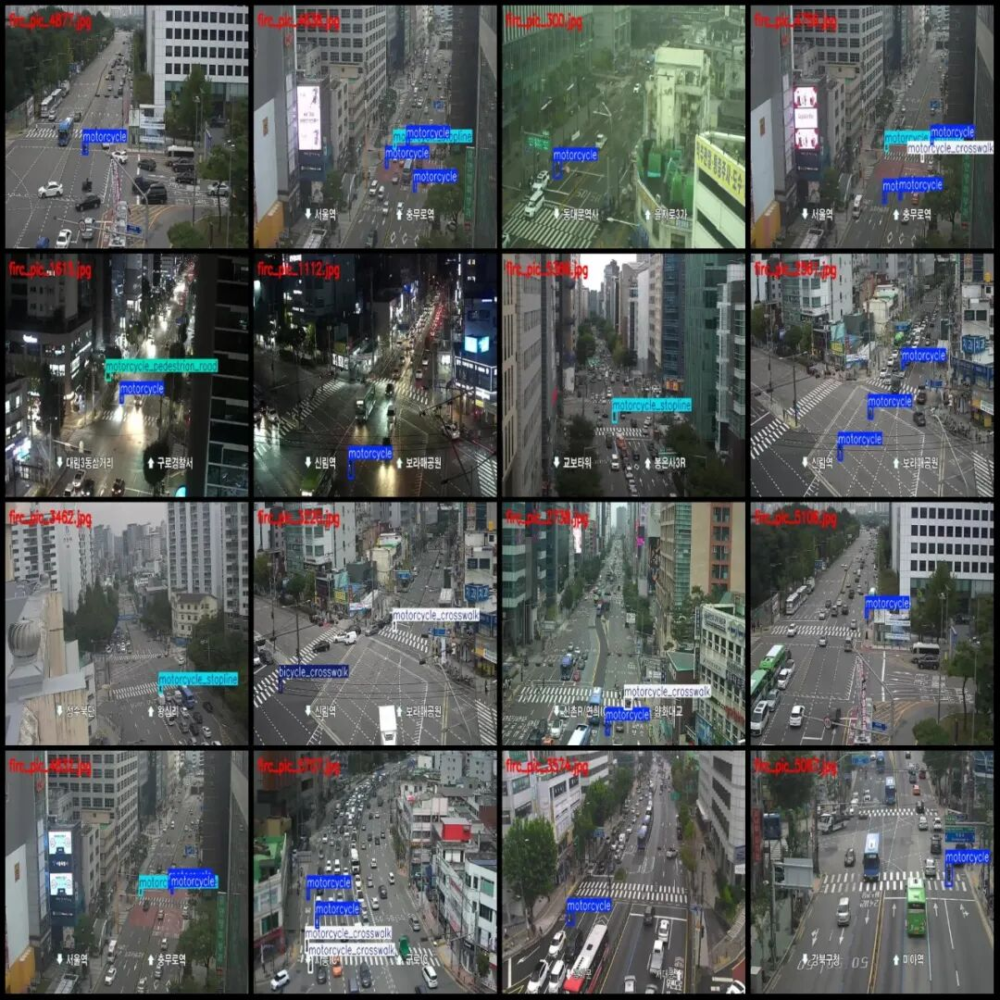

# Monitoring Perspective Non-motorized Vehicle Illegal Traffic Behavior Detection Motorcycle and Bicycle Violation Behavior Detection Dataset VOC+YOLO Format 5861 Images 9 Categories

Dataset format: Pascal VOC format + YOLO format (txt file without split path, only containing jpg images and corresponding VOC format xml files and yolo format txt files)

Number of images (number of jpg files): 5861

Number of annotations (number of xml files): 5861

Number of annotations (number of txt files): 5861

Label category count: 9

Label category names (Note that the order of yolo format categories does not correspond to this, but is based on the classes.txt in the labels folder): ["bicycle", "bicycle_crosswalk", "bicycle_pedestrian_road", "bicycle_stopline", "motorcycle", "motorcycle_crosswalk", "motorcycle_jaywalk", "motorcycle_pedestrian_road", "motorcycle_stopline"]

Number of boxes labeled in each category:

Bicycle (bicycle) Frame Count = 162

Bicycle_crosswalk (bicycle crossing the zebra crossing) Frames = 151

Complete English text:

bicycle_stopline (Bicycle Stop Line) Frame Count = 1

Motorcycle (motorcycle) Frame Count = 7870

Motorcycle crossing the zebra crossing (motorcycle crossing the zebra line) Frames = 1137

Motorcycle Jaywalking (Motorcycle Crossing Traffic Signal) Frames = 66

Motorcycle Pedestrian Road (Motorcycles on Pedestrian Street) Frame Count = 47

Motorcycle_stopline (Motorcycle crossing the stop line) Frames = 1100

Total frame count: 10585

Number of images per category:

Bicycle (bicycle) occupies 149 images.

Bicycle_crosswalk (Bike crossing the zebra line) occupies = 149

Bicycle_pedestrian_road (On a bicycle on the sidewalk) occupies = 51

bicycle_stopline (Bicycle Stop Line) occupies = 1

Motorcycle (motorcycle) occupies a picture count = 4901

Motorcycle crosswalk (Motorcycle crossing the zebra line) occupies a picture count = 987

Motorcycle Jaywalking (Motorcycles crossing the street red light/violating traffic rules) occupies a picture count = 65

Motorcycle Pedestrian Road (Motorcycle on Pedestrian Road) occupies 45 images.

Motorcycle_stopline (Motorcycle Stop Line) occupies = 878

Image resolution: 640x360

Using labelImg:

Annotation rules: Draw a rectangle around the category.

Important Notice: The dataset does not have separate training, validation, and test sets; you need to partition them yourself.

Special : This dataset does not guarantee the accuracy of the trained models or weight files.

Image Preview:

Annotation example:

## Payment

Here is a pay link on Stripe ( https://buy.stripe.com/3cs8yP7sY87d0vu9AB ). Please contact me lonlonago@foxmail.com after funding $89, and I will send you a complete data files , thank you!

